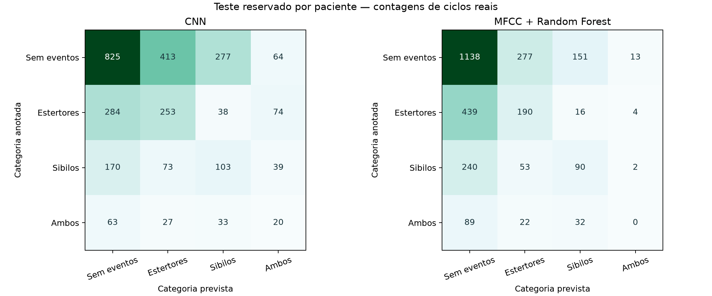
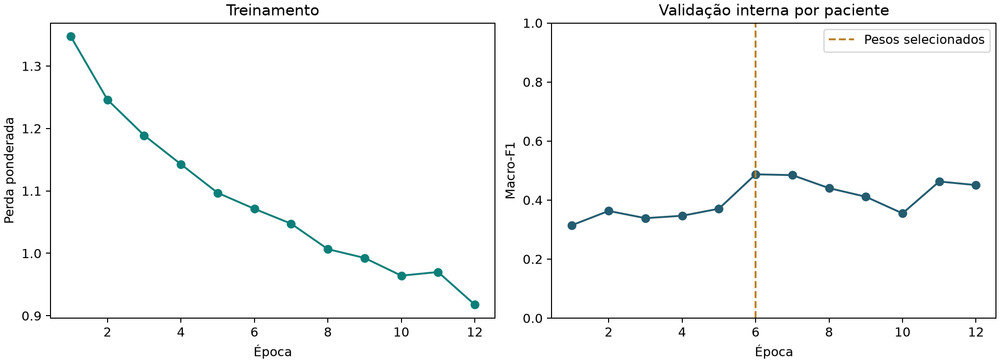

# Relatório acadêmico — implementação experimental

**Título da implementação:** Classificação de sons respiratórios adventícios por processamento de áudio e redes neurais convolucionais.

**Autores, instituição e orientação:** a preencher pela equipe. **Versão:** implementação de 26/10/2026, com resultados reais. O tema geral inicial incluía arritmias; a implementação entregue avalia somente sons respiratórios.

## Resumo

Foi desenvolvido um protótipo local de classificação de ciclos respiratórios usando aprendizado supervisionado. A base ICBHI 2017 foi obtida de um espelho acadêmico com integridade verificada e auditada para impedir sobreposição de pacientes. Foram usados 6781 ciclos, dos quais 2756 pertencem ao teste reservado. Compararam-se uma CNN compacta, um modelo de características cepstrais com Random Forest e um preditor de classe majoritária. A CNN alcançou macro-F1 de 0.3216, acurácia de 0.4358 e escore ICBHI de 0.4210. O resultado foi modesto e não estabelece utilidade clínica. A aplicação permite selecionar um trecho, gerar sua representação e inspecionar uma previsão experimental, com métricas e limitações explícitas.

**Palavras-chave:** ausculta digital; processamento de áudio; aprendizado supervisionado; CNN; sons respiratórios.

## 1. Introdução e delimitação

Este trabalho investiga a classificação de padrões acústicos em gravações de ausculta. A literatura inclui modelos para reconhecer sibilos, estertores e sua combinação [1, 2]. A proposta temática inicial também incluía fibrilação atrial por áudio [3], mas essa tarefa exige dados e confirmação de ritmo próprios. Não foi obtida uma base apropriada para executá-la nesta versão.

A contribuição entregue é um procedimento reproduzível de organização dos dados, preparação dos sinais, treinamento, avaliação e demonstração local. O reconhecimento de categorias acústicas é distinguido do diagnóstico de doenças e da comprovação de detecção clínica precoce.

## 2. Problema, hipótese e objetivos

A pergunta foi se uma CNN consegue reconhecer as categorias em pacientes reservados e superar um classificador convencional na macro-F1. O objetivo foi implementar, comparar e documentar os modelos e uma aplicação demonstrativa. A superioridade da CNN não foi assumida como condição para relatar resultados.

## 3. Dados e protocolo

Utilizou-se a ICBHI 2017 [2], com 920 gravações e 126 pacientes. A origem, os termos, os hashes e a aquisição estão em [DADOS.md](DADOS.md). A auditoria encontrou os pacientes 156 e 218 tanto no treino quanto no teste da lista original espelhada. Foram removidas apenas suas 13 gravações de treino (117 ciclos); os 381 arquivos e 2.756 ciclos do teste original foram preservados.

O conjunto final contém 62 pacientes de treino (3594 ciclos), 15 de validação (431 ciclos) e 49 de teste (2756 ciclos). Não há pacientes ou conteúdo PCM compartilhados entre partições. As classes são ausência dos dois eventos, estertores, sibilos e ambos. Ausência desses eventos não equivale a ausência de doença.

## 4. Processamento e modelos

Os limites dos ciclos foram obtidos das anotações. Cada trecho foi preparado com reamostragem para 4.000 Hz, normalização por pico e espectrograma log-Mel de 64 faixas. A STFT usa janela de 256 amostras e salto de 64. A faixa dinâmica é de 80 dB. O ciclo completo foi interpolado para 256 posições temporais, sem truncamento do final; isso preserva a extensão do ciclo, mas pode alterar a representação de eventos curtos.

A CNN possui blocos convolucionais com 16, 32 e 64 canais, agregação adaptativa e camadas densas, totalizando 154804 parâmetros. Foi treinada com AdamW, taxa de aprendizado 0.0007, lote 32, perda ponderada pelas classes de treinamento e semente 42. A seleção ocorreu pela macro-F1 na validação: época 6 entre 12 executadas, com interrupção após seis épocas sem melhoria.

O modelo convencional usa média e desvio de 20 coeficientes cepstrais derivados da mesma representação e Random Forest com 250 árvores. Um classificador de maioria contextualiza a influência do desequilíbrio. Nenhuma configuração foi ajustada após consultar o teste final.

## 5. Avaliação e resultados

Unidade de avaliação: ciclo respiratório. A macro-F1 é a média do F1 das quatro categorias. Especificidade por classe usa um-contra-os-demais. O escore ICBHI combina o acerto da categoria exata dos ciclos anormais e o acerto dos ciclos sem eventos.

| Modelo | Macro-F1 | Acurácia balanceada | Acurácia | Escore ICBHI |
| --- | ---: | ---: | ---: | ---: |
| Classe majoritária | 0.1821 | 0.2500 | 0.5729 | 0.5000 |
| MFCC + Random Forest | 0.3098 | 0.3118 | 0.5145 | 0.4793 |
| CNN | 0.3216 | 0.3299 | 0.4358 | 0.4210 |

O IC95% de macro-F1 da CNN por bootstrap de pacientes foi [0.2737; 0.3686], com 500 reamostragens. Esse intervalo não é um teste de significância da diferença entre os modelos.

As métricas completas por categoria e as previsões individuais estão em [RESULTADOS.md](../reports/RESULTADOS.md) e `reports/test_predictions.csv`.

## 6. Discussão e limitações

A CNN obteve macro-F1 ligeiramente maior que o modelo convencional neste teste reservado. A acurácia e o escore ICBHI da CNN ficaram abaixo do preditor de classe majoritária. Portanto, essa diferença pontual em macro-F1 não demonstra superioridade geral; o desempenho é insuficiente para uso clínico. O resultado depende da população, dos equipamentos e do procedimento de representação. O número de pacientes é limitado e as categorias são desequilibradas. A comparação com trabalhos que utilizam partições diferentes ou permitem sobreposição de pacientes exige considerar essa diferença metodológica.

O protótipo classifica um ciclo delimitado e não detecta automaticamente respirações em gravações contínuas. Pontuações de softmax não são probabilidades clínicas calibradas. A avaliação não demonstra benefício clínico, diagnóstico de doença ou antecipação do diagnóstico. O módulo de arritmia está indisponível e não é simulado.

## 7. Aplicação e verificação

A interface local foi implementada com HTML/CSS/JavaScript e API FastAPI, sem CDN. Ela recebe WAV, permite selecionar e ouvir um ciclo, exibe forma de onda e espectrograma, aplica os pesos salvos e exporta a análise em JSON. Uploads não são adicionados ao treinamento.

O treinamento e a inferência compartilham o mesmo processamento float32. O pacote inclui código, pesos, métricas, quatro exemplos reais de teste, documentação e testes. A base completa é obtida pelo downloader e não está redistribuída integralmente no pacote.

As verificações cobrem áudio, partições, anotações, artefatos, API, arquivos inválidos, origem dos exemplos e coerência das métricas. Consultar [QA independente](QA_INDEPENDENTE.md) para resultados de testes e retestes efetivamente registrados. Fixtures artificiais servem apenas a testes de software, nunca à avaliação científica. Repetir previsões nos mesmos pacientes verifica reprodução; não constitui validação em novos pacientes.

## 8. Conclusão

Foi entregue um protótipo experimental que executa o fluxo de classificação e explicita seus resultados. A avaliação demonstrou limitações importantes do modelo, apesar da macro-F1 superior à referência de maioria e ligeiramente superior ao modelo convencional. Não há evidência suficiente para recomendar uso clínico. A continuação deve investigar representações temporais, generalização e dados independentes, com um novo protocolo de avaliação reservado para evitar adaptação ao teste já consultado.

## Referências

[1] PETMEZAS, G. et al. Automated Lung Sound Classification Using a Hybrid CNN-LSTM Network and Focal Loss Function. *Sensors*, 2022. [Artigo](https://doi.org/10.3390/s22031232).

[2] ROCHA, B. M. et al. An open access database for the evaluation of respiratory sound classification algorithms. *Physiological Measurement*, 2019. [Artigo](https://doi.org/10.1088/1361-6579/ab03ea).

[3] GUO, Y. et al. Detection of atrial fibrillation via artificial intelligence-assisted auscultation. *BMC Cardiovascular Disorders*, 2025. [Artigo](https://doi.org/10.1186/s12872-025-05236-z).

Completar dados da equipe e adaptar a formatação às exigências da instituição. Não foi declarada conformidade com uma norma acadêmica específica.
