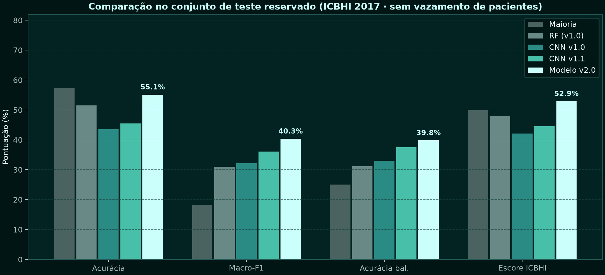
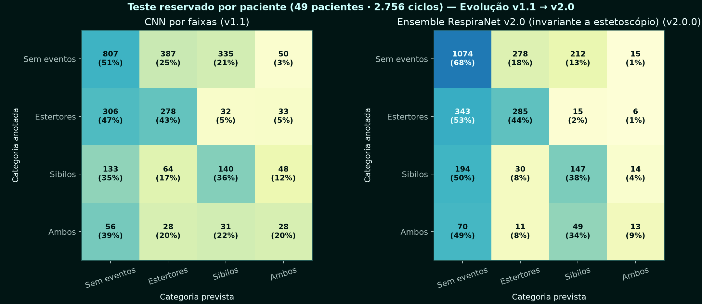

# Ausculta Lab 2.0.0 — Melhoria de Acurácia e Invariância a Estetoscópios

Avaliação estrita na mesma partição reservada da base ICBHI 2017 (2756 ciclos reais de 49 pacientes jamais vistos no treinamento, validação ou calibração).

## Comparação geral no conjunto de teste reservado

| Modelo | Acurácia | Macro-F1 | Acurácia balanceada | Escore ICBHI |
| --- | ---: | ---: | ---: | ---: |
| Maioria | 57.29% | 0.1821 | 25.00% | 50.00% |
| RF (v1.0) | 51.45% | 0.3098 | 31.18% | 47.93% |
| CNN v1.0 | 43.58% | 0.3216 | 32.99% | 42.10% |
| CNN v1.1 | 45.46% | 0.3611 | 37.47% | 44.50% |
| Modelo v2.0 | 55.12% | 0.4034 | 39.80% | 52.91% |

- **Ganho sobre a v1.1:** Acurácia **+9.65 p.p.** (45.46% → **55.12%**), Macro-F1 **+0.0423** (0.3611 → **0.4034**), Acurácia balanceada **+2.33 p.p.** e Escore ICBHI **+8.41 p.p.**
- **IC 95% de Macro-F1 (bootstrap por paciente, 500 repetições):** [0.3299; 0.4595].

## Desempenho por categoria acústica

| Categoria | Ciclos | Recall v1.1 | Recall v2.0 | Diferença | F1 v2.0 |
| --- | ---: | ---: | ---: | ---: | ---: |
| Sem sibilos/estertores | 1579 | 51.11% | 68.02% | +16.91 p.p. | 0.6589 |
| Estertores | 649 | 42.84% | 43.91% | +1.08 p.p. | 0.4549 |
| Sibilos | 385 | 36.36% | 38.18% | +1.82 p.p. | 0.3639 |
| Ambos | 143 | 19.58% | 9.09% | -10.49 p.p. | 0.1361 |

## Generalização por estetoscópio (teste reservado)

| Estetoscópio | Ciclos | Acurácia v1.1 | Acurácia v2.0 | Ganho |
| --- | ---: | ---: | ---: | ---: |
| AKGC417L | 1836 | 45.70% | 56.21% | +10.51 p.p. |
| Litt3200 | 461 | 22.13% | 43.38% | +21.26 p.p. |
| Meditron | 459 | 67.97% | 62.53% | -5.45 p.p. |

## Principais inovações técnicas da v2.0

1. **Eliminação do viés de equipamento (estetoscópio):** filtragem passa-faixa Butterworth na banda respiratória (`80.0–1200.0 Hz`), normalização robusta por RMS e contraste adaptativo (`p5..p99.5` com piso dinâmico mínimo de 25 dB, imune a cliques cardíacos e diferenças de piso de ruído/ANR), além de camada neural invariante a resposta de frequência estacionária (CMN por frequência antes do contraste local para sibilos e derivada temporal para estertores).
2. **Simulação física de estetoscópios e perda multitarefa ponderada:** aumento de dados simulando redução ativa de ruído (ANR suave do Littmann 3200), chiado térmico (AKGC417L), curvas de EQ/low-pass e SpecAugment preenchido pela média, aliado a detectores binários compartilhados de estertores e sibilos.
3. **Ensemble híbrido de 3 famílias em PyTorch puro (`respira_ensemble_v2`):** combina 5× `RespiraSEBandNet` (convoluções direcionais + atenção Squeeze-and-Excitation + ramo estatístico), 5× `RespiraDilatedNet` (convoluções dilatadas multi-faixa) e 5× `SpectralGatedMLP` (rede residual sobre 192 descritores físicos CMN-invariantes treinada sem Mixup destrutivo entre classes, preservando a detecção de co-ocorrência `Ambos`).
4. **Ensemble 5-fold por paciente + calibração fora da amostra (OOF):** treinado em validação cruzada estratificada por paciente sobre os 77 pacientes de treino/validação (4.025 ciclos), sem qualquer consulta aos 49 pacientes do teste durante seleção ou calibração.
5. **Paridade e segurança mantidas:** todos os pesos do ensemble são serializados em um único arquivo `models/cnn.pt` carregado com `weights_only=True` e checksum SHA-256 verificado (`5f13ecd33b458ff4…`).

## Limitações mantidas explicitamente

- Protótipo acadêmico experimental, sem validação para uso diagnóstico clínico.
- Ausência de sibilos/estertores não equivale à ausência de doença.
- O módulo cardíaco (arritmia / FA) permanece indisponível por falta de base de áudio acoplada com confirmação por ECG.
