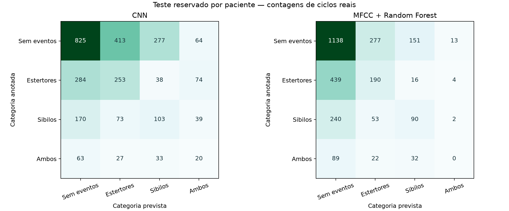
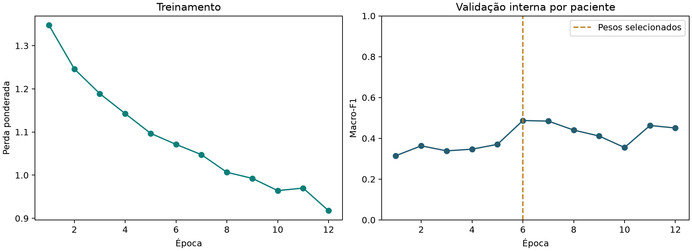

# Resultados experimentais reais

Registro histórico da versão 1.0. A comparação com o modelo ativo está no [relatório da versão 1.1](REFINAMENTO_CNN.md).

Os valores abaixo foram gerados pelos artefatos do treinamento. Nenhum áudio sintético foi usado nas métricas científicas. Fixtures artificiais existem exclusivamente nos testes de software.

## Dados e protocolo

ICBHI 2017, obtida por espelho acadêmico com integridade verificada. Foram auditados 920 arquivos, 126 pacientes e 6898 ciclos originais. Após excluir 117 ciclos de gravações de treino dos pacientes presentes no teste original, restaram 6781 ciclos.

| Partição | Pacientes | Ciclos |
| --- | ---: | ---: |
| train | 62 | 3594 |
| validation | 15 | 431 |
| test | 49 | 2756 |

O teste original foi preservado. Pacientes 156 e 218 estavam em treino e teste da lista espelhada; suas 13 gravações de treino foram excluídas antes da validação interna. O protocolo difere de avaliações que permitem essa sobreposição. Não houve ajuste do modelo com base no teste final.

## Resultados no teste

Unidade: ciclo respiratório; 2756 ciclos e 49 pacientes reservados.

| Modelo | Macro-F1 | Acurácia balanceada | Acurácia | Escore ICBHI |
| --- | ---: | ---: | ---: | ---: |
| Classe majoritária | 0.1821 | 0.2500 | 0.5729 | 0.5000 |
| MFCC + Random Forest | 0.3098 | 0.3118 | 0.5145 | 0.4793 |
| CNN | 0.3216 | 0.3299 | 0.4358 | 0.4210 |

Intervalo de confiança de 95% para macro-F1 da CNN, por bootstrap de pacientes (500 repetições): **0.2737 a 0.3686**. Esse intervalo descreve incerteza amostral dentro desta avaliação; não demonstra validade clínica externa.

## Resultados da CNN por categoria

| Categoria | Ciclos | Sensibilidade | Especificidade um-contra-os-demais | F1 |
| --- | ---: | ---: | ---: | ---: |
| Sem sibilos/estertores | 1579 | 0.5225 | 0.5607 | 0.5649 |
| Estertores | 649 | 0.3898 | 0.7565 | 0.3576 |
| Sibilos | 385 | 0.2675 | 0.8532 | 0.2464 |
| Ambos | 143 | 0.1399 | 0.9323 | 0.1176 |

## Configuração executada

- CNN: Conv(16)-Conv(32)-Conv(64)-AdaptivePool(4,8)-FC64-FC4; 154804 parâmetros.
- Entrada: log-Mel 64×256; 4.000 Hz; STFT 256; salto 64; faixa dinâmica de 80 dB; ciclo inteiro interpolado no tempo, sem truncar o final.
- Treino: 12 épocas executadas, máximo de 18; seleção da época 6 pela macro-F1 de validação.
- Otimizador: AdamW, taxa 0.0007; lote 32; semente 42; pesos de classe calculados somente no treino.
- Cache e inferência float32; sem quantização intermediária das representações.
- Ambiente: Python 3.13.2, PyTorch 2.14.1+cpu, NumPy 2.5.4.
- Duração registrada do pipeline: 263.3 segundos; inclui auditoria e características quando não havia cache.
- Pesos SHA-256: `aa69b383ae7b5a1cd4585a0dcc8d9e3a8ad6244cd3b84a3bb2d5db1110d03650`.

## Interpretação

A CNN obteve macro-F1 ligeiramente maior que o modelo convencional neste teste reservado. A acurácia e o escore ICBHI da CNN ficaram abaixo do preditor de classe majoritária. Portanto, essa diferença pontual em macro-F1 não demonstra superioridade geral; o desempenho é insuficiente para uso clínico. O resultado é experimental. A rede reconhece padrões das categorias usadas neste conjunto; não é um sistema validado de diagnóstico ou de triagem clínica. As diferenças entre dispositivos e a pequena diversidade de pacientes limitam generalização. O redimensionamento temporal pode prejudicar eventos breves.

O módulo cardíaco de arritmia permanece indisponível por ausência de uma base de áudio apropriada com confirmação do ritmo. Seu funcionamento não é simulado nesta aplicação.

## Evidências e verificações

- `models/metrics.json`: métricas completas e definições.
- `models/model.json`: configuração e integridade do modelo.
- `reports/test_predictions.csv`: rótulos e previsões de todos os ciclos do teste.
- `data/manifest.audit.json`: auditoria e exclusões, por gravação.
- `docs/QA_INDEPENDENTE.md` e `reports/qa/`: testes e retestes; conferir o estado registrado nesses arquivos.

Os quatro exemplos distribuídos foram escolhidos por ordem de paciente/gravação, um por categoria, sem seleção por acerto do modelo. O reteste não constitui uma nova amostra de pacientes.
